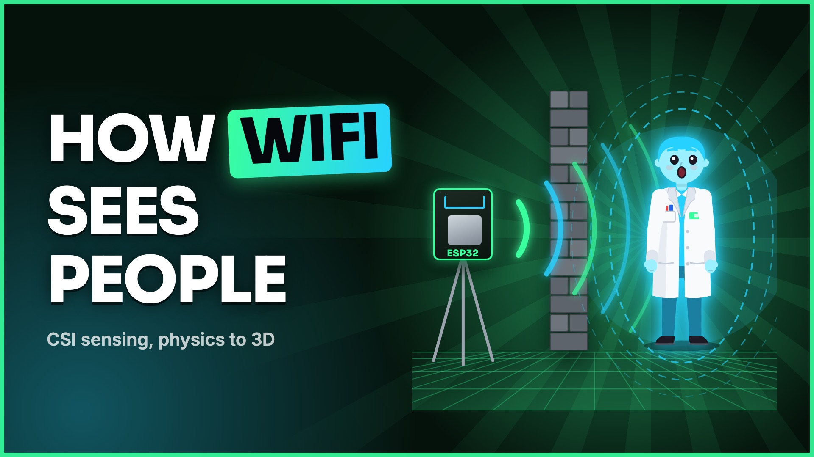
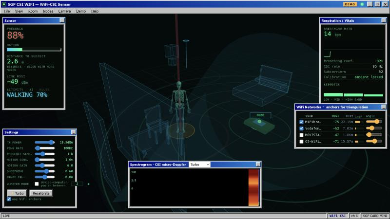
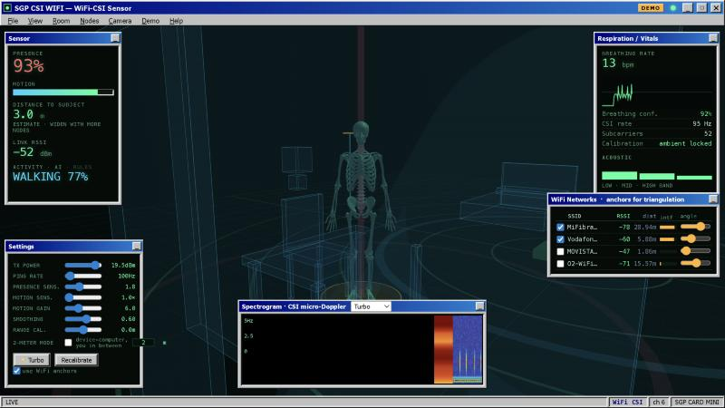
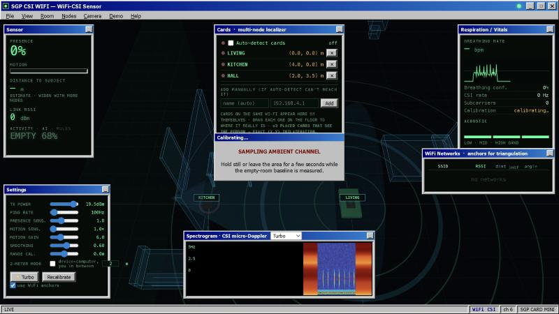
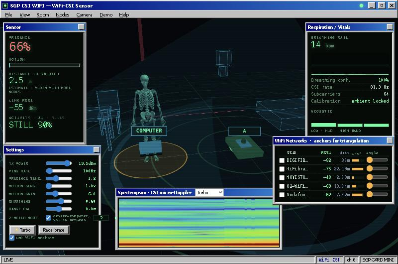

<div align="center">

# WiFi CSI — Human Sensing with Ordinary WiFi

**Detect presence, motion, breathing, activity and 3D position of a person — using nothing but a WiFi radio.**
No camera. No wearable. Just the Channel State Information every WiFi packet already carries.

[](https://www.sgpstore.net)
[](https://youtu.be/YgvoR9122Ic)
[](LICENSE)

### ▶️ Watch the full technical breakdown

[](https://youtu.be/YgvoR9122Ic)

*7‑minute explainer: the physics of CSI, OFDM sub‑carriers, the DSP chain, the AI and 3D localization.*

<br>



</div>

---

## What is this?

An **ESP32‑S3 WiFi card** reads how people disturb the 2.4 GHz radio channel — the **Channel State Information (CSI)** — and streams it raw to your computer, which runs all the signal processing, the AI and a live 3D view.

A moving (or even just breathing) body reflects and absorbs 2.4 GHz energy, subtly changing the amplitude and phase of every WiFi sub‑carrier. Read those changes carefully and a person becomes a signal you can measure.

> 🛒 **Get the hardware:** the **SGP Card Mini** and other RF/maker boards are available at **[sgpstore.net](https://www.sgpstore.net)**.

### Two parts

```
  SGP Card Mini  ──WiFi (raw CSI)──▶   Your computer
  (dumb sensor)                        (DSP + AI + 3D view)
```

1. **`firmware/`** — the card. A pure sensor: it enables CSI capture and streams the raw channel over UDP. No heavy maths on the card.
2. **`pc/`** — the program. Receives the stream and runs cleaning, self‑calibration, presence / motion / breathing detection, activity AI, optional multi‑node trilateration, and a real‑time 3D visualizer in the browser.

## What one card can and can't do (honest)

- ✅ **Presence, motion, breathing rate, activity and a distance estimate** — reliable with a single card.
- ✅ A **3D view** placing the person at the estimated position with an uncertainty cone.
- ⚠️ **Exact (x, y) position** is *not* physically possible with one single antenna. Add **2–3 more cards** as anchors and the program runs **least‑squares trilateration** when ≥3 nodes see the person. One card = range + presence; three cards = real coordinates.

## Features

| | |
|---|---|
| 📡 **Raw CSI capture** | 64 sub‑carriers from the L‑LTF of every packet, ~100+ Hz |
| 🧍 **Presence & motion** | z‑scored against a live, self‑learning empty‑room baseline |
| 🫁 **Breathing** | band‑pass + FFT → breaths per minute, with a scrolling micro‑Doppler spectrogram |
| 🧠 **Activity AI** | CSINet (1D CNN + bidirectional GRU): empty / still / walking / fast / fall — rules mode works instantly, neural mode trains on your hardware |
| 📐 **Multi‑node localization** | drag each card onto the floor; ≥3 → least‑squares trilateration |
| 🔍 **Auto‑detection** | cards on the same WiFi appear by themselves, deduplicated by MAC |
| 📏 **2‑Meter Mode** | device ↔ computer line‑of‑sight, person crosses between |
| ⚡ **Turbo + max sensitivity** | dedicated high‑rate firmware; crank it until a hand over the card registers |
| 🦴 **3D visualizer** | holographic X‑ray anatomy that breathes with you, plus optional webcam‑pose fusion |

## Gallery

| 3D anatomy + vitals | Multi‑node room | 2‑Meter Mode |
|:---:|:---:|:---:|
|  |  |  |

## How WiFi CSI works (in one minute)

WiFi uses **OFDM**, which splits one channel into dozens of narrow **sub‑carriers**. For every packet the radio measures the **amplitude and phase** of each sub‑carrier — about **64 independent samples of the channel per packet**. Stack them over time and you get the **CSI matrix**. A person in the room perturbs those sub‑carriers in step with their motion and breathing. The PC cleans the stream (Hampel filter), learns the quiet baseline, and turns the deviations into presence, motion, breathing and activity.

## Quick start

### 1. Flash the card

Board: **ESP32‑S3** · Partition **Huge APP** · Flash **8 MB** · Library: **Adafruit NeoPixel**. Two sketches:

- **`firmware/SGPCard_CSI_Node/`** — the standard node (single card in AP mode, or set `STATION_MODE 1` + your WiFi to use several cards on one network).
- **`firmware/SGPCard_CSI_Turbo/`** — a single‑device, maximum‑rate, maximum‑sensitivity build that makes its own WiFi.

### 2. Run the program

```bash
cd pc
./run.command            # macOS/Linux: sets up a venv, launches, opens the browser
# or:  python3 sgpcard.py
```

- **One card:** join the card's WiFi `SGP_SGPCARD_xxxx` (or `SGP_TURBO_xxxx`) and run the program — it auto‑detects the card.
- **Several cards:** flash each with `STATION_MODE 1` pointing at one WiFi (e.g. a phone hotspot in 2.4 GHz), run the program, and the cards appear by themselves in the **Nodes** panel. Drag each to its real spot; with ≥3 you get real (x, y) coordinates.

> No hardware yet? `python3 simnode.py` in one terminal and `python3 sgpcard.py --node 127.0.0.1` in another runs a synthetic breathing person end‑to‑end.

## How it works (architecture)

```
Card: esp_wifi_set_csi → per‑packet CSI → UDP ─▶ PC
PC:  Hampel clean → sub‑carrier select → baseline calibration
     → motion (σ over noise floor) → presence (logistic)
     → breathing (band‑pass + FFT) → activity (CSINet)
     → range / trilateration → three.js 3D view
```

## Project structure

```
firmware/
  SGPCard_CSI_Node/    standard CSI node (AP or station mode)
  SGPCard_CSI_Turbo/   single‑device high‑rate build
pc/
  sgpcard.py           DSP + AI + trilateration + web/websocket server
  simnode.py           software card simulator (no hardware needed)
  ai/                  CSINet model, rules/neural engine, record + train
  web/                 three.js 3D visualizer (self‑contained, works offline)
docs/                  screenshots and the video thumbnail
```

## Licensing & attribution

The original code is **MIT** (see [`LICENSE`](LICENSE)). Third‑party components keep their own licenses:

- The **3D anatomy models** in `pc/web/models/` derive from **BodyParts3D** and **Z‑Anatomy** and are redistributed under **CC BY‑SA 4.0** — see [`pc/web/models/CREDITS.txt`](pc/web/models/CREDITS.txt).
- Rendering uses **three.js** (MIT); mesh decompression uses **Google Draco** (Apache‑2.0).
- Research code vendored in `pc/ai/vendor/` (**SenseFi**, **ArielM1904/Wifi‑CSI**) keeps its own MIT licenses.

---

<div align="center">

### Built by **SGP** · [**sgpstore.net**](https://www.sgpstore.net)

RF, maker and sensing gadgets — including the **SGP Card Mini** that powers this project.

[](https://www.sgpstore.net) &nbsp; [](https://youtu.be/YgvoR9122Ic)

</div>
